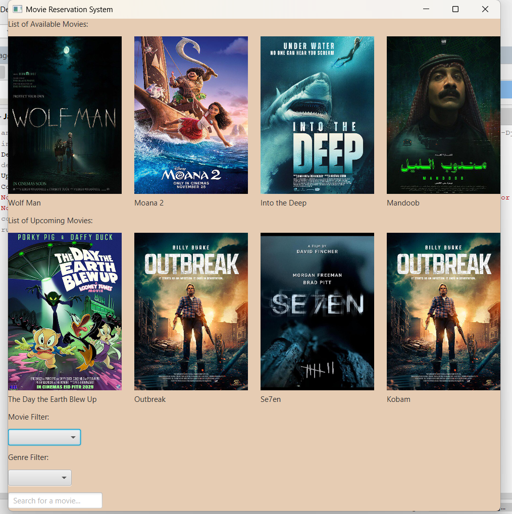
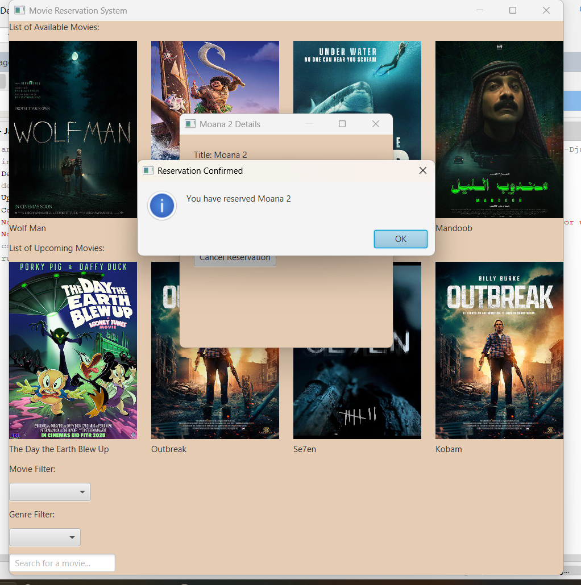
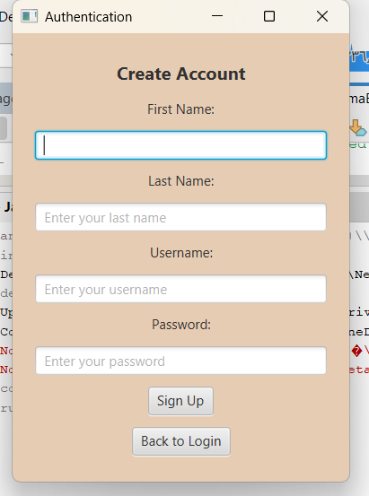
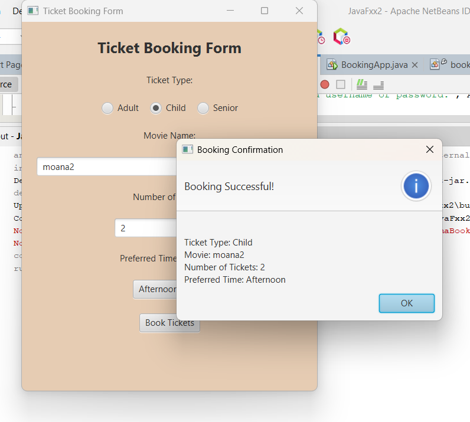

# Cinema Reservation System

A university desktop application for browsing movies, filtering and searching the catalog, viewing movie details, creating a local account, booking tickets, viewing offers, and managing reservation records.

The interface is built with JavaFX and the optional persistence layer uses MySQL through JDBC.



## Features

- Available and upcoming movie catalog
- Search and genre filtering
- Movie details and reservation confirmation
- Account sign-up and login screens
- Ticket type, quantity, and time selection
- MySQL-backed users and booking records

## Technology

- Java 21
- JavaFX 21
- MySQL / JDBC
- Maven

## Run locally

1. Install JDK 21, Maven, and MySQL.
2. Run `database/schema.sql` in MySQL.
3. Set the database environment variables shown below.
4. Start the application with `mvn clean javafx:run`.

```text
CINEMA_USERS_DB_URL=jdbc:mysql://localhost:3306/userdb?useSSL=false
CINEMA_BOOKINGS_DB_URL=jdbc:mysql://localhost:3306/bookingdb?useSSL=false
CINEMA_DB_USER=root
CINEMA_DB_PASSWORD=your-local-password
```

The movie catalog can open without a database connection. Database-backed account and booking actions require MySQL.

## Security note

No database password is committed to this repository. Configuration is read from environment variables. This is an academic prototype; a production system should additionally hash account passwords and use a dedicated least-privilege database user.

## More screenshots

| Reservation | Create account | Ticket booking |
| --- | --- | --- |
|  |  |  |
